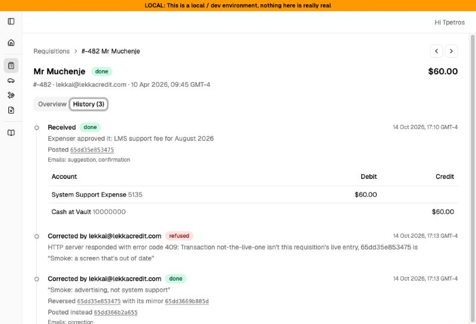
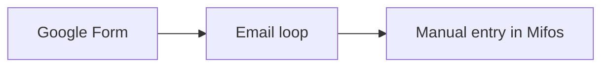
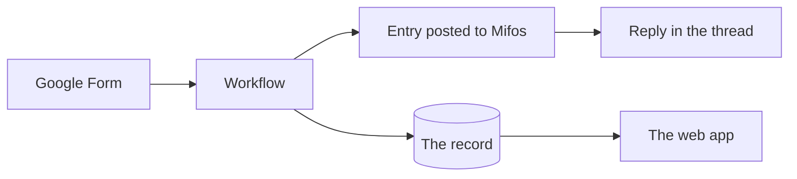
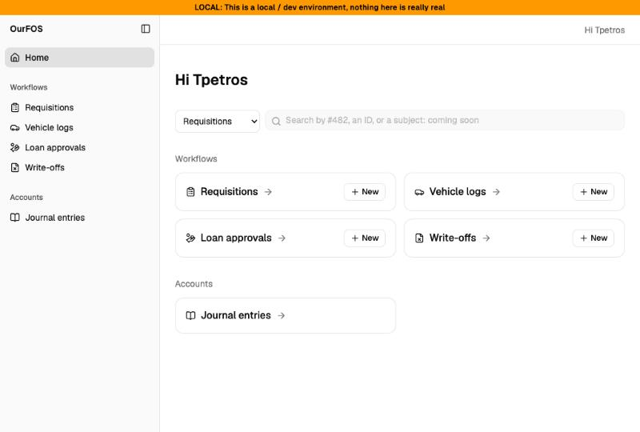
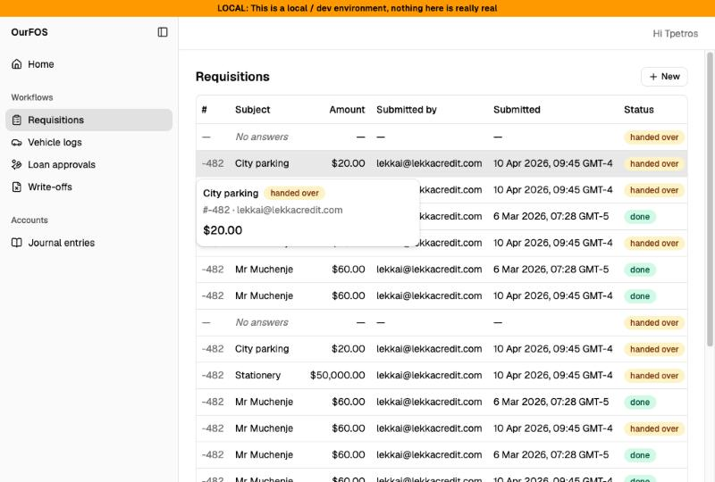
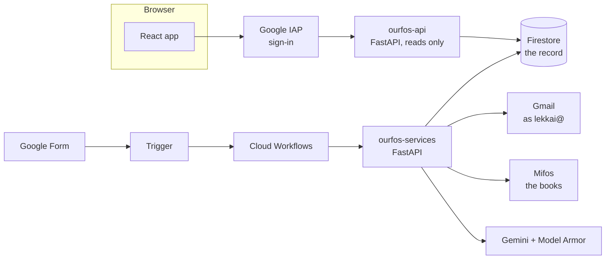
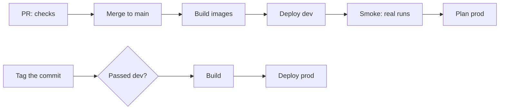

# OurFOS

Lekka Credit's back office: forms in, books out. A microlender's paperwork, turned into workflows that file the ledger entry themselves, and a web app to see all of it.



## The problem

Every request in the business was a Google Form, then a thread of emails, then someone typing it into Mifos, the core banking system, by hand.

- **Separate workflows** for requisitions, vehicle logs, loan approvals and write-offs, each with its own form and its own habits
- **Where a request stood lived in email threads**: who approved it, whether it was booked, what was booked
- **Manual entry**, mostly by the one accountant, for every expense



## What it does now

A form starts a workflow. It reads the requisition and its receipts, decides how to book it, posts the journal entry to Mifos, and replies in the same email thread with what it did. Every step is recorded, and the web app shows it.



Live on prod, in beta. Posting to the books is a switch on each form's link, held off on prod until corrections can be made from the web app.

## The web app

Everyone at Lekka signs in with their Google account. They see every form's submissions and every ledger entry we've posted, and where each one stands.

| Home | A list, with a row peeking on hover |
| --- | --- |
|  |  |

- **A record is a page of its own.** A breadcrumb leads back to the page of the list you came from. ← and → step through the list, into its next page when one runs out
- **Overview, then History.** Overview is where a record stands: its answers, then the entry live in the books. History tells its story, oldest first, with each posting's ledger lines inline, corrections included
- **Files open where you are**: Drive's own preview, or ours streamed through the API, in a modal
- **Built for poor connections.** Our field staff work on patchy mobile data. Pages load their code only when opened, the library code stays cached between releases, lists keep the page you're on while the next loads, and a flaky call is retried
- **Small things done properly**: skeletons shaped like what's coming, a tooltip on every icon, keyboard navigation, a sidebar that gets out of the way on a record and remembers when you want it back, times in your own zone with the zone named, and a red banner on every non-production page so test data is never mistaken for the books

## How it's built



- **Frontend**: React 19, TypeScript in strict mode, Vite, Tailwind 4 and shadcn, React Router, TanStack Query, Zustand
- **Backend**: Python and FastAPI on Cloud Run, Cloud Workflows to run each request's steps, Firestore, and Gemini behind Model Armor to read the receipts
- **Infra**: Terraform, in this repo and [lekka-ourfos-infra](https://github.com/tinopetros/lekka-ourfos-infra), deployed by Cloud Build

## Frontend decisions worth talking about

Each was written down when it was made, with what wasn't chosen and why ([phase 13's ADRs](docs/phase13/adr.md)).

- **Types flow from the API to the browser.** The API's Pydantic models generate its OpenAPI, which generates the app's TypeScript. A response the UI misreads fails to compile, and CI fails if the two drift apart (ADR 4)
- **The API's data in TanStack Query, what only the browser knows in Zustand.** Caching, refetching and stale data are Query's job, never a hand-rolled store's (ADR 6)
- **No auth code in the app.** Google's IAP signs people in before a request reaches us. The API checks one signed header (ADR 3)
- **A backend for the frontend.** The UI's API is its own service, with its own account that can read and can't post: browsers never reach the routes that touch money (ADR 2)
- **Conventions written down**, after [bulletproof-react](https://github.com/alan2207/bulletproof-react): a folder per feature with its own queries, imports from `@/`, tests beside what they test (ADR 12)
- **Read only, first.** Seeing everything clearly comes before changing anything from the UI. Actions, then permissions by group, come next

## Other decisions

- **Capability, rolled out gradually.** Receive and acknowledge first, then classify, then post, each live before the next ([phases](docs/))
- **Workflows, not a queue of our own.** Each request's steps, retries and handovers to a person are Cloud Workflows', and every run is on the record
- **The model is evaluated, not trusted.** Expenser, the agent that reads receipts, is scored against 36 real requisitions with ADK's own evals, and every prompt it gets is screened by Model Armor first
- **Never post twice.** A post that times out hands over to a person rather than retry. A correction is a mirror entry, then the corrected one, both on the original's date, so the period it was booked in still balances
- **Spend caps and one instance.** Budgets cap the model's spend, and the services run on a single instance

## How it ships



Every PR runs the backend's tests, the UI's lint, types, tests and build, and checks the generated types are current. Merging deploys dev and runs real workflows against it. Prod only takes a commit that passed dev.

## Next

- **Actions from the UI**: submitting forms, then correcting and reversing entries, through the same workflows
- **Permissions by Workspace group**: what each person sees in a list, and what they may do
- **The field, offline**: a native app for staff on patchy connections, queueing submissions until they're back ([#30](https://github.com/tinopetros/lekka-ourfos/issues/30))
- **Live runs**: a record's history filling in as its workflow runs
- **Integration tests from the UI's side** ([#34](https://github.com/tinopetros/lekka-ourfos/issues/34))

## Run it

```bash
make web
```

The UI on http://localhost:5173, and its API beside it, signed in as your own Google account, reading dev's data. It installs and generates the types first.

The working details, from running a workflow by hand to deploying, are in [the handbook](docs/handbook.md). Each phase's design and decisions are in [docs](docs/).
