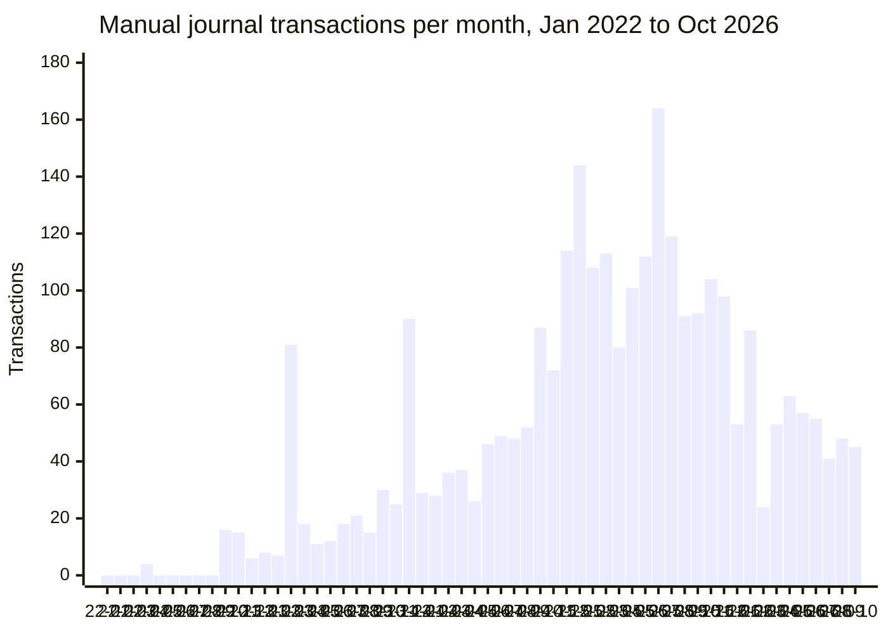
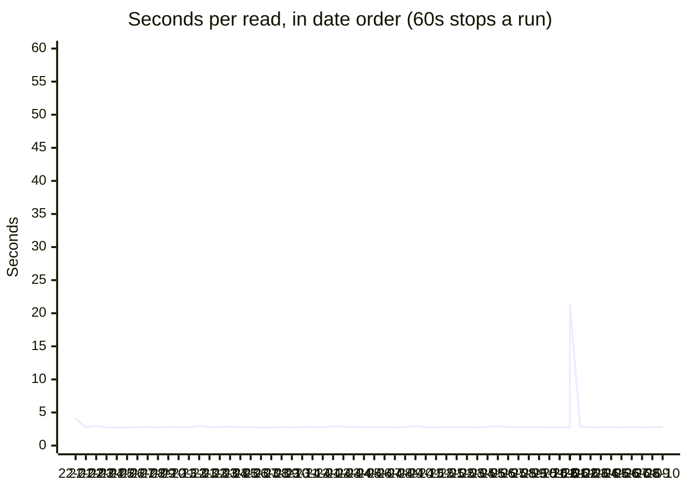

# Manual journal entries: the backfill

Every manual journal entry in prod Mifos's `default` tenant, read a range at a time on Oct 31 2026 and kept in
`gs://ourfos-prod-mifos/manual_journal_entries/`, one file a range (ADRs 4 and 5). Each range's timing is in that
folder's `_perf.jsonl`.

- **64 files, 2,852 transactions, 5,982 lines**, April 2022 to October 2026 (October still open)
- Every read one page. All but one answered in 2.7–4.1s; the week of 26 Jan 2026 took 21.3s
- Mifos cut one read off (April 2026), read in 2.8s minutes later; one week timed out at 65s on the first run (16 Feb
  2026) and read in 2.9s an hour later
- Weeks from 29 Dec 2025 to 15 Feb 2026, as the first run went; 16 Feb–15 Mar and 16–31 Mar round onto calendar
  months, which every other file is

## Transactions per month

Early 2026's weeks are added into the month they start in.

## Seconds per read

## By year

| Year | Transactions | Lines | Empty months | Reads | Booked by (months active) |
|---|---:|---:|---:|---|---|
| 2022 | 41 | 87 | 8 | 2.72–4.12s | dgoto\* 4, smataruka\* 2, AMasvaure 1, admin 1 |
| 2023 | 336 | 822 | 0 | 2.73–2.98s | dgoto\* 10, AMasvaure 7, admin 5, smataruka\* 4, ZSaruchera 2, KMbinda\* 2 |
| 2024 | 624 | 1,357 | 0 | 2.74–2.95s | ZSaruchera 10, AMasvaure 8, LTanga 6, smataruka\* 5, KMbinda\* 4, LGovera\* 2, RPanyangara 1 |
| 2025 | 1,326 | 2,653 | 0 | 2.72–2.89s | ZSaruchera 13 |
| 2026 | 525 | 1,063 | 0 | 2.73–21.31s | ZSaruchera 15, lekkai@lekkacredit.com 3, TPSuperUser 2 |

\* Mifos users since deleted; Mifos keeps their entries under `<n>_DELETED_<name>`. Years go by each file's first day,
so 29–31 Dec 2025 count in 2025.

## Worth a look

- April 2022 has 4 entries, six months before the first client was activated (28 Oct 2022); none Jan–Mar or May–Sep
  2022. 2021 may hold setup entries too, unread
- Bookkeeping passed from dgoto (2022–23) to AMasvaure (2023–24) to ZSaruchera (2024 on). `admin` booked entries in
  2022 and 2023
- lekkai@ booked 3 entries in April 2026 and 2 in May, before ourfos posted real requisitions from 29 Oct; TPSuperUser
  3 and 2 in the same months
- 2025 is the busiest year, 1,300 transactions; July 2025 the busiest month, 164
